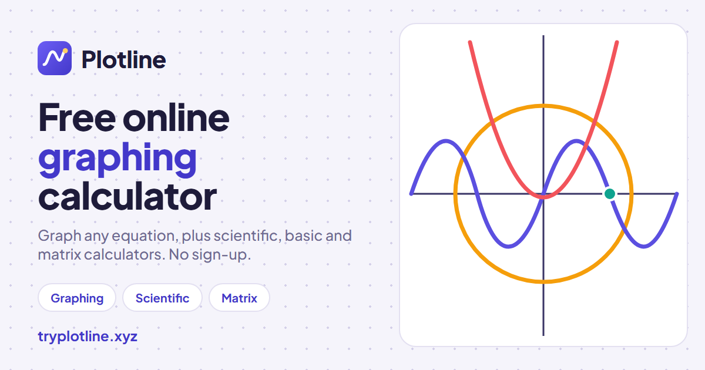

# Plotline

**A free online graphing, scientific, basic and matrix calculator. No sign-up, works offline.**

[](https://tryplotline.xyz/)

**[Open Plotline → tryplotline.xyz](https://tryplotline.xyz/)**

Plotline is four calculators in one page, built so that someone using a graphing calculator for the first time can open it and start straight away. There is no account and nothing to install, and it keeps working without an internet connection after the first visit.

## Calculators

| | What it does |
|---|---|
| **[Graphing](https://tryplotline.xyz/)** | Plots equations as you type: functions, circles and other implicit curves, inequalities with shading, polar and parametric curves. Sliders animate any variable; tap a curve to read its coordinates. |
| **[Scientific](https://tryplotline.xyz/scientific-calculator)** | Logs in any base, roots, powers, factorials, and trigonometry in degrees or radians, with history and `ans`. |
| **[Basic](https://tryplotline.xyz/basic-calculator)** | A four-function calculator with percentages and big keys for phones. |
| **[Matrix](https://tryplotline.xyz/matrix-calculator)** | Determinants, inverses, RREF, multiplication and systems of equations, with answers in exact fractions. |

Every calculator has an on-screen keypad and one-click examples you can edit.

## Features

- **No account.** Graphs save in your browser ("My graphs"), export and import as JSON, and share as a link that carries the whole graph.
- **Save as image.** One tap downloads the graph as a PNG (or opens the share sheet on a phone), with a small `tryplotline.xyz` credit in the corner.
- **Works offline.** Plotline is a progressive web app: install it from Chrome, Edge or Safari on a phone or computer.
- **Guides.** 24 pages explain common graphs and matrix operations, from [the sine graph](https://tryplotline.xyz/graphs/sine) to [RREF](https://tryplotline.xyz/rref-calculator). Each one opens the calculator with its example already loaded. Browse them in the [graph library](https://tryplotline.xyz/graphs).
- **Free.** No ads, no paid tier, nothing behind a login.

Plotline does less than the big tools: there is no 3D, geometry, data tables or classroom mode. See [how it compares with Desmos](https://tryplotline.xyz/desmos-alternative).

## How it's built

Plotline is TypeScript on Vite, with no UI framework. The math is its own engine:

- **Parser and compiler** (`src/math`): LaTeX from the input is tokenized, parsed and compiled to plain JavaScript functions. The same engine powers graphing, scientific and basic.
- **Renderer** (`src/graphing`): a canvas plotter with adaptive sampling for `y = f(x)`, marching squares for implicit curves, and shading for inequalities.
- **Linear algebra** (`src/matrix`): exact-fraction arithmetic, so an inverse comes out as `3/5` rather than `0.6`.
- **Pre-rendered pages** (`src/seo`, `vite.config.ts`): every calculator and guide is written into static HTML at build time, with its own title, structured data and readable content, so search engines and AI assistants see real pages without running JavaScript. The build also writes `sitemap.xml`, `llms.txt` and the guide illustrations.

Math input uses [MathLive](https://cortexjs.io/mathlive/).

## Run it locally

Requires Node.js 20.19+ or 22.12+.

```bash
npm install
npm run dev
```

Then open http://localhost:5173.

| Command | What it does |
|---|---|
| `npm run dev` | Development server with hot reload |
| `npm run build` | Type-check, then build the static site into `dist/` |
| `npm run preview` | Serve the built site locally |
| `npm test` | Run the unit tests (Vitest) |

## Project layout

| Folder | Contents |
|---|---|
| `src/shell` | Top bar, calculator tabs and routing (old `#/…` links still work) |
| `src/math` | LaTeX parser, compiler and multi-line analysis |
| `src/graphing` | Expression list, sliders, keypad and canvas renderer |
| `src/scientific`, `src/fourfunction` | Keypad calculators with history |
| `src/matrix` | Exact-fraction linear algebra and the matrix UI |
| `src/storage` | Save, My graphs, JSON export/import and share links |
| `src/seo` | Page content, guides, FAQs and structured data |
| `public` | Icons, social image, `robots.txt` |

## Feedback

Found a bug, a wrong answer or something confusing? Open an issue or email **aalok.builds@gmail.com**.

Plotline is an independent project made by Aalok. It is not affiliated with Desmos, Texas Instruments or Casio.
